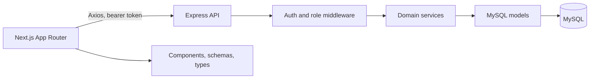
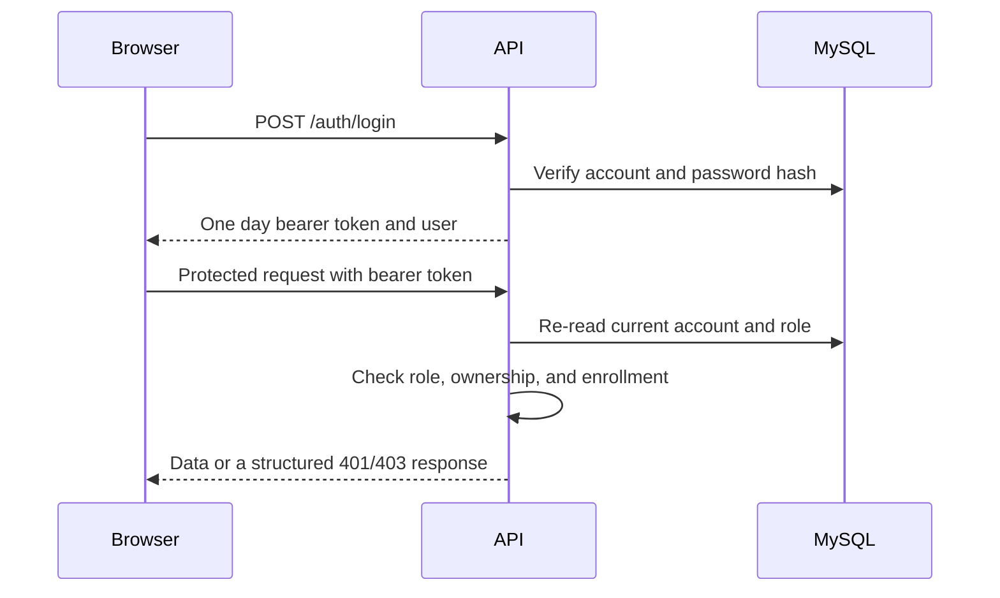

# LMS Platform

A full stack learning management system built with Next.js, Express, TypeScript, and MySQL. The project supports role based course management, student enrollment, lessons, and course completion tracking.

## Run locally

Requirements: Node.js, npm, and Docker Desktop (or a local MySQL 8 server).

1. Install dependencies:

   ```bash
   npm ci --prefix apps/backend
   npm ci --prefix apps/frontend
   ```

2. Start MySQL when using Docker:

   ```bash
   docker compose up -d mysql
   ```

3. Create the database tables. In MySQL Workbench, run [`docs/database.sql`](docs/database.sql) using a database account allowed to create tables. Existing installations created from the older schema should apply [`docs/migrations/001-course-category-and-progress.sql`](docs/migrations/001-course-category-and-progress.sql) once.

4. Copy `apps/backend/.env.example` to `apps/backend/.env` and `apps/frontend/.env.example` to `apps/frontend/.env.local`. Set a unique `JWT_SECRET` with at least 32 characters before deployment. In local development, if it is omitted, the backend generates a temporary secret on startup, so users will need to sign in again after a backend restart.

5. Start the API and frontend in separate terminals:

   ```bash
   npm run dev --prefix apps/backend
   npm run dev --prefix apps/frontend
   ```

   The frontend runs at `http://localhost:3000`; the API runs at `http://localhost:5000/api`.

Registration creates student accounts. To make an instructor or administrator for local development, register a user and update that account's `role` in the `users` table. The API reloads the current role from MySQL on each authenticated request, so role changes take effect immediately.

## Architecture



Frontend routes are organized under `src/app` route groups: `(public)`, `(auth)`, and `(dashboard)`. Shared interface components live in `src/components`; API calls, validation schemas, and TypeScript types are separated into `src/services`, `src/schemas`, and `src/types`. The Express API follows routes → middleware/controllers → services → models.

### Roles and learning flow

- **Student:** browse and search courses, enroll, view enrolled lessons, and mark lessons complete.
- **Instructor:** create courses and lessons and manage only courses they own.
- **Admin:** manage users and all courses and lessons.
- Enrollment is required before a student can open course lessons. Course completion percentage is calculated from completed lessons.
- The backend enforces roles, ownership, enrollment, and input validation. Frontend guards only improve navigation and feedback.
- Browser sessions currently use `localStorage` bearer tokens for this learning project. Before production with untrusted scripts or sensitive learner data, move sessions to secure, `HttpOnly`, `SameSite` cookies and add CSRF protections.

### Authentication request flow



## Quality checks

```bash
npm run lint --prefix apps/frontend
npm run typecheck --prefix apps/frontend
npm test --prefix apps/backend
npm run typecheck --prefix apps/backend
npm run build --prefix apps/frontend
```

## Configuration and deployment

Backend configuration is read from environment variables documented in `apps/backend/.env.example`; frontend API URL is set with `NEXT_PUBLIC_API_URL`. Set production origins in `FRONTEND_ORIGINS`, use a stable random JWT secret, enable HTTPS, and use a managed database with backups. Apply SQL migrations as part of deployment and never commit `.env` files.

There is no hosted demo or production deployment configured in this repository yet. Add deployment-specific secrets, a production database, CI credentials, and screenshots before presenting a live portfolio demo.

See [`docs/project-status.md`](docs/project-status.md) for completed roadmap items and remaining work.
